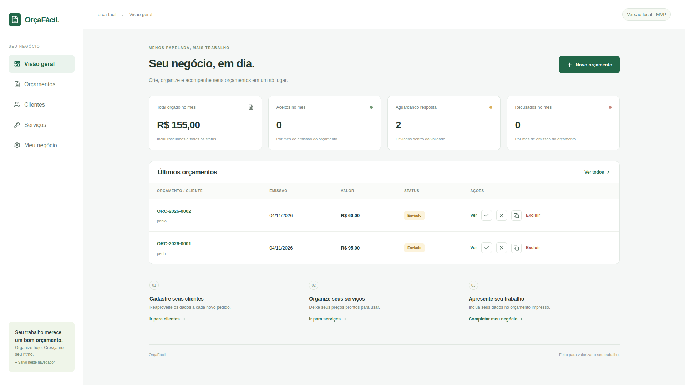
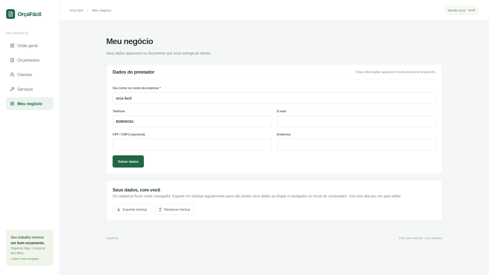

# OrçaFácil

Aplicação web para prestadores de serviço autônomos criarem e acompanharem orçamentos. Reúne cadastro de clientes, catálogo de serviços, propostas e dados do negócio em uma interface adaptada para computador e celular.

A versão atual funciona com armazenamento no navegador, sem cadastro de conta ou banco de dados remoto.



## Funcionalidades

- **Visão geral:** total orçado no mês, propostas aceitas, recusadas e aguardando resposta.
- **Clientes:** cadastro, busca, edição e exclusão de contatos.
- **Serviços e produtos:** catálogo com descrição, unidade e preço para reutilizar nos orçamentos.
- **Orçamentos:** itens do catálogo ou manuais, descontos, acréscimos, validade e condições de pagamento.
- **Acompanhamento:** numeração sequencial, duplicação e controle de rascunhos, enviados, aceitos, recusados e expirados.
- **Documento:** impressão, opção de salvar como PDF e resumo para compartilhar pelo WhatsApp.
- **Meu negócio:** dados do prestador e exportação ou restauração de backup JSON.

## Telas

### Dados do negócio e backup

Os dados do prestador são usados no documento entregue ao cliente. Nesta tela também ficam as opções de exportar e restaurar os cadastros.



### Versão no celular

O layout reorganiza a navegação e os indicadores para telas menores.


## Tecnologias

| Tecnologia | Uso |
| --- | --- |
| React e TypeScript | Interface e regras da aplicação |
| React Hook Form e Zod | Formulários e validação dos dados |
| Lucide | Ícones |
| CSS e Tailwind CSS | Estilos, responsividade e impressão |
| Vinext e Vite | Desenvolvimento e build |
| Cloudflare Workers | Runtime da aplicação compilada |

## Instalação

Requer **Node.js 22.13 ou superior** e **npm**. Na pasta do projeto, execute:

```bash
npm ci
npm run dev
```

Abra o endereço informado pelo terminal. A aplicação começa com os cadastros vazios.

## Verificações e build

```bash
npm run typecheck
npm run lint
npm test
npm run build
```

Para conferir a versão compilada, execute `npm start` depois de `npm run build`. A prévia usa `vite preview` e escuta apenas em `127.0.0.1`. Esse comando não publica o aplicativo na internet.

## Estrutura

O projeto usa as convenções de rotas do Next.js por meio do Vinext.

- `app/page.tsx`: navegação, painel e lista de orçamentos.
- `app/globals.css`: estilos, responsividade e impressão.
- `components/catalogs.tsx`: clientes, serviços e dados do prestador.
- `components/quote-editor.tsx`: formulário de orçamento.
- `components/quote-document.tsx`: documento e compartilhamento.
- `lib/domain.ts`: cálculos, datas, numeração e status.
- `lib/storage.ts`: persistência e validação de backups.
- `lib/*.test.ts`: testes de cálculo e armazenamento.
- `worker/index.ts`: entrada do Cloudflare Worker.
- `docs/images/`: capturas de tela usadas neste README.

## Uso

1. Preencha os dados do prestador em **Meu negócio**.
2. Cadastre um cliente e, se quiser, um catálogo de serviços.
3. Crie um orçamento com itens, validade e condições de pagamento.
4. Salve o rascunho e abra **Ver** para revisar o documento.
5. Imprima ou salve como PDF. O botão do WhatsApp abre um resumo para revisão e envio manual.
6. Marque o orçamento como enviado e registre a resposta do cliente.
7. Exporte um backup regularmente em **Meu negócio**.

## Regras

- Numeração `ORC-AAAA-0001`, com sequência global sem reutilização após exclusões. Cópias recebem um novo número.
- Preços aceitam duas casas decimais e quantidades aceitam três. Cada item é arredondado para centavos antes da soma.
- O desconto incide sobre o subtotal; o acréscimo é somado depois. O total mínimo é zero.
- Apenas rascunhos podem ser editados. O fluxo é `draft → sent → accepted / rejected / expired`, sem reabertura de estados finais.
- Orçamentos enviados vencem no dia seguinte à validade. Rascunhos e orçamentos aceitos ou recusados não expiram automaticamente.
- Os dados do cliente são copiados para o orçamento. Editar o cadastro não altera documentos existentes; editar o rascunho atualiza essa cópia.
- Clientes com orçamentos não podem ser excluídos. Remover um serviço preserva os itens já orçados.
- Os dados do prestador são os atuais de **Meu negócio**, sem histórico de alterações.
- O painel agrupa valores pelo mês de emissão. O total orçado inclui todos os status e não representa pagamentos recebidos.
- Backups têm limite de 5 MiB e são validados antes da substituição dos dados, com confirmação.

## Dados e privacidade

Clientes, serviços e orçamentos ficam no `localStorage`, separado por navegador e endereço do site. Não há login, sincronização entre dispositivos ou recuperação pela nuvem. Limpar os dados do navegador pode apagá-los. Use uma aba por vez para editar e mantenha backups.

Backups JSON contêm os dados dos clientes e do prestador, incluindo contatos, endereço e CPF/CNPJ quando preenchidos. Guarde-os fora do repositório ou na pasta `backups/`, ignorada pelo Git. Não publique backups reais em issues ou capturas de tela.

O `.gitignore` exclui credenciais, variáveis de ambiente, backups, bancos locais, logs, dependências e arquivos gerados. Arquivos já versionados não são protegidos por essas regras. A aplicação atual não exige credenciais de API.

Antes de enviar alterações ao GitHub, confira:

```bash
npm audit
git status --short --untracked-files=all
git add --dry-run .
```

Versione `package-lock.json` e revise qualquer arquivo incluído com `git add -f`. Se uma credencial for publicada, revogue-a; removê-la do último commit não a apaga do histórico.

## Dependências

Na revisão de 04/11/2026, a auditoria apontou 13 alertas moderados ligados ao `minimatch` nas ferramentas de lint, sem alertas altos ou críticos. A [correção do minimatch](https://github.com/isaacs/minimatch/security/advisories/GHSA-g3hv-75wg-m249) está na versão 11.0.1; as ferramentas instaladas dependem das séries 3 e 10. Evite `npm audit fix --force`, que atualmente sugere versões incompatíveis.

O override de `fflate` em `package.json` mantém a correção 0.7.5 na dependência do Satori.
